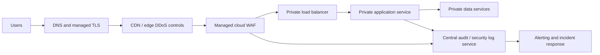

# Proposed cloud design

## Design notes

- Put a managed WAF at the public edge, with TLS certificates managed centrally and only approved hostnames exposed.
- Permit application ingress only from the load balancer or WAF security group; do not give app instances public IPs.
- Start in count/detection mode, establish a representative traffic baseline, review false positives with application owners, then enable blocking in stages. Version and review exclusions narrowly; do not broadly disable rule groups to quiet alerts.
- Send WAF, load balancer, application, and identity logs to centralized storage with access controls, retention, and alerts. Redact secrets and sensitive values; define an incident response owner and alert thresholds.
- Use separate dev, test, and production policies; manage rules as reviewed infrastructure-as-code and roll changes through staged deployment with rollback.
- Add rate limiting and bot controls where supported, but treat those as complementary to application authorization, input validation, patching, and secure coding.
- Validate performance, regional availability, privacy and retention requirements, cost, and the cloud provider's managed-rule semantics before selecting a service.

The local lab demonstrates request inspection and log review. Its scope excludes TLS termination, distributed traffic, identity, resilience, and managed cloud WAF behavior.
