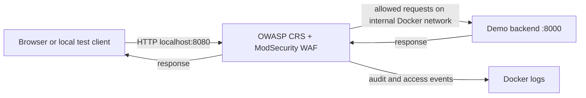

# Traffic flow

Only the WAF port is published, bound to `127.0.0.1`. The backend has no host port and is attached only to an internal Docker network shared with the WAF. The WAF also joins a front bridge network for the host port mapping. The intended request path is `browser → WAF → demo app`; requests blocked by the WAF do not reach the backend.
